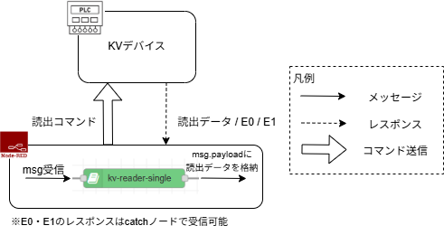
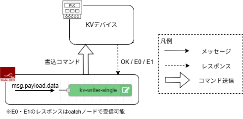
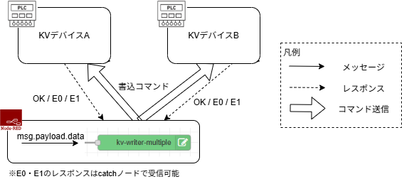
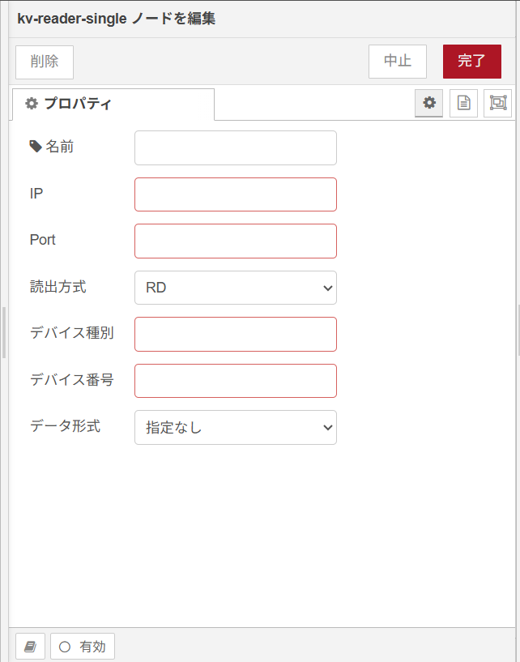
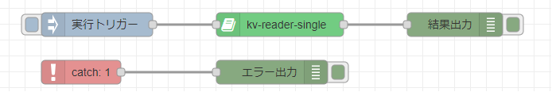
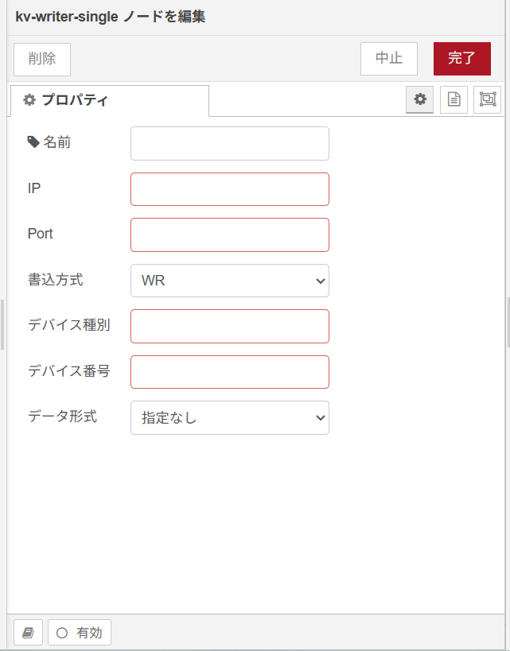
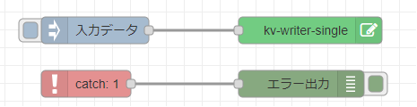
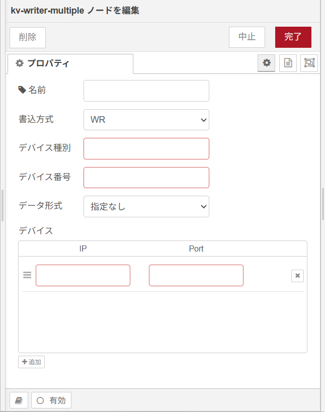
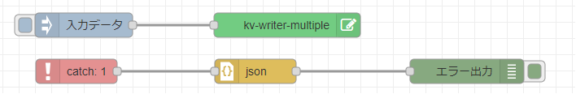

# node-red-kv

## 目次

* [概要](#概要)
* [機能](#機能)
* [ノードの設定](#ノードの設定)
  * [環境変数](#環境変数)
    * [環境変数の値](#環境変数の値)
  * [コンテナーの作成オプション Create Option](#コンテナーの作成オプション-create-option)
    * [コンテナーの作成オプション Create Option の値](#コンテナーの作成オプション-create-option-の値)
* [ノードライブラリの説明](#ノードライブラリの説明)
  * [kv-reader-single](#kv-reader-single)
  * [kv-writer-single](#kv-writer-single)
  * [kv-writer-multiple](#kv-writer-multiple)
* [ログ出力内容](#ログ出力内容)
* [エラー時動作一覧](#エラー時動作一覧)
* [Feedback](#feedback)
* [LICENSE](#license)

## 概要

node-red-kvは、下記処理を行うNode-REDのカスタムノードです。

## 機能

kvデバイスに対しデータの読出や書き込みを行う機能。  
以下のノードを含む。

* kv-reader-single デバイスからデータ読出を行う。  


* kv-writer-single デバイスへデータ書き込みを行う。  


* kv-writer-multiple 複数デバイスへ一括データ書き込みを行う。  


## ノードの設定

### 環境変数

#### 環境変数の値

(なし)

### コンテナーの作成オプション Create Option

#### コンテナーの作成オプション Create Option の値

(なし)

## ノードライブラリの説明

<a id="Node-Specification-kv-reader-single"></a>

### kv-reader-single

#### 機能概要

  デバイスからのデータ読出を行う。  
  ノードから出力されるmsg.payloadにはデバイスから読出したデータがそのまま格納されるため、  
  後続ノードにてデータの分割や結合を行うこと。

#### プロパティ

  

  | プロパティ   | Type       | Required | Conditions                                                        | Default          | Description                                                                                                                                                                                                                                                                                            |
  | ------------ | ---------- | -------- | ----------------------------------------------------------------- | ---------------- | ------------------------------------------------------------------------------------------------------------------------------------------------------------------------------------------------------------------------------------------------------------------------------------------------------ |
  | 名前         | textbox    |          |                                                                   | kv-reader-single | ノードの表示名を設定。                                                                                                                                                                                                                                                                                 |
  | IP           | textbox    | 〇       | IPv4形式　or localhost                                            |                  | KVデバイスIP。                                                                                                                                                                                                                                                                                         |
  | Port         | textbox    | 〇       | 1以上 65535以下の整数<br>指数表記不可                             |                  | KVデバイスポート番号。                                                                                                                                                                                                                                                                                 |
  | 読出方式     | selectlist | 〇       | [RD,RDS]                                                          | RD               | 読出方式を選択する。<br>RD：データ読出<br>RDS：連続データ読出                                                                                                                                                                                                                                          |
  | デバイス種別 | textbox    | 〇       |                                                                   |                  | KVデバイス種別。                                                                                                                                                                                                                                                                                       |
  | デバイス番号 | textbox    | 〇       | 0以上の整数<br>指数表記不可                                       |                  | KVデバイス番号。                                                                                                                                                                                                                                                                                       |
  | データ形式   | selectlist | 〇       | [.U,.S,.D,.L,.H,指定なし]                                         | 指定なし         | データ形式。<br>※ KVマニュアルを確認し種別に応じて変更する。<br>マニュアルはKEYENCE公式サイトからダウンロード可能。<br>.U：10進数16ビット符号なし<br>.S：10進数16ビット符号あり<br>.D：10進数32ビット符号なし<br>.L：10進数32ビット符号あり<br>.H：16進数16ビット<br>指定なし：KVデバイスのデフォルト  |
  | 読出個数     | textbox    | △        | 読出方式=RDS時のみ表示され設定必須<br>1以上の整数<br>指数表記不可 |                  | 読み出す個数。                                                                                                                                                                                                                                                                                         |

#### 入力メッセージ

なし(実行トリガーとしてのみ利用される)

#### 出力メッセージ

| JSON Key | Type   | Description |
| -------- | ------ | ----------- |
| payload  | string | 読出結果    |

##### 出力メッセージ例

``` json
{
  "payload": "00100"
}
```

#### 使用例１

　[フロー構成]

  

  [プロパティ]

  | プロパティ   | Value      |
  | ------------ | ---------- |
  | IP           | デバイスIP |
  | Port         | ポート番号 |
  | 読出方式     | RD         |
  | デバイス種別 | DM         |
  | デバイス番号 | 10000      |
  | データ形式   | .U         |

  [入力メッセージ]

  なし(実行トリガーとしてのみ利用される)

  [KVデバイスからの出力]

  ```text
  "00090"
  ```

  [出力メッセージ]

  ```json
  {
    "_msgid":"メッセージid",
    "payload":"00090"
  }
  ```

#### 使用例2

　[フロー構成]

  

  [プロパティ]

  | プロパティ   | Value      |
  | ------------ | ---------- |
  | IP           | デバイスIP |
  | Port         | ポート番号 |
  | 読出方式     | RDS        |
  | デバイス種別 | DM         |
  | デバイス番号 | 10000      |
  | データ形式   | .U         |
  | 読出個数     | 2          |

  [入力メッセージ]

  なし(実行トリガーとしてのみ利用される)

  [KVデバイスからの出力]

  ```text
  "00315 0000"
  ```

  [出力メッセージ]

  ```json
  {
    "_msgid":"メッセージid",
    "payload":"00315 0000"
  }
  ```

<a id="Node-Specification-kv-writer-single"></a>

### kv-writer-single

#### 機能概要

  デバイスへのデータ書き込みを行う。  
  ノードへの入力msg.payloadには、dataをキーとして書き込みデータ本文を格納すること。

#### プロパティ

  

  | プロパティ   | Type       | Required | Conditions                            | Default          | Description                                                                                                                                                                                                                                                                                       |
  | ------------ | ---------- | -------- | ------------------------------------- | ---------------- | ------------------------------------------------------------------------------------------------------------------------------------------------------------------------------------------------------------------------------------------------------------------------------------------------- |
  | 名前         | textbox    |          |                                       | kv-writer-single | ノードの表示名を設定。                                                                                                                                                                                                                                                                            |
  | IP           | textbox    | 〇       | IPv4形式　or localhost                |                  | KVデバイスIP。                                                                                                                                                                                                                                                                                    |
  | Port         | textbox    | 〇       | 1以上 65535以下の整数<br>指数表記不可 |                  | KVデバイスポート番号。                                                                                                                                                                                                                                                                            |
  | 書込方式     | selectlist | 〇       | [WR,WRS]                              | WR               | 書込方式を選択する。<br>WR：データ書込<br>WRS：連続データ書込                                                                                                                                                                                                                                     |
  | デバイス種別 | textbox    | 〇       |                                       |                  | KVデバイス種別。                                                                                                                                                                                                                                                                                  |
  | デバイス番号 | textbox    | 〇       | 0以上の整数<br>指数表記不可           |                  | KVデバイス番号。                                                                                                                                                                                                                                                                                  |
  | データ形式   | selectlist | 〇       | [.U,.S,.D,.L,.H,指定なし]             | 指定なし         | データ形式。<br>※ KVマニュアルを確認し種別に応じて変更する。マニュアルはKEYENCE公式サイトからダウンロード可能。<br>.U：10進数16ビット符号なし<br>.S：10進数16ビット符号あり<br>.D：10進数32ビット符号なし<br>.L：10進数32ビット符号あり<br>.H：16進数16ビット<br>指定なし：KVデバイスのデフォルト |

#### 入力メッセージ

| JSON Key   | Type         | Description            |
| ---------- | ------------ | ---------------------- |
| payload    | object       | 書込データオブジェクト |
| &emsp;data | string array | 書込データ             |

##### 入力メッセージ例

```json
{
"payload": {
  "data": [
      "+15025",
      "-05400", 
      "200"
    ]
  }
}
```

#### 出力メッセージ

なし

#### 使用例１

　[フロー構成]

  

  [プロパティ]

  | プロパティ   | Value      |
  | ------------ | ---------- |
  | IP           | デバイスIP |
  | Port         | ポート番号 |
  | 書込方式     | WR         |
  | デバイス種別 | DM         |
  | デバイス番号 | 10000      |
  | データ形式   | .S         |

  [入力メッセージ]

  ```json
  {
  "payload": {
    "data": [
        "+15025",
        "-05400", 
        "200"
      ]
    }
  }
  ```

  [出力メッセージ]

  なし

<a id="Node-Specification-kv-writer-multiple"></a>

### kv-writer-multiple

#### 機能概要

  複数デバイスへのデータ書き込みを一括して行う。  
  ノードへの入力msg.payloadには、dataをキーとして書き込みデータ本文を格納すること。

#### プロパティ

  

  | プロパティ   | Type         | Required | Conditions                            | Default            | Description                                                                                                                                                                                                                                                                                       |
  | ------------ | ------------ | -------- | ------------------------------------- | ------------------ | ------------------------------------------------------------------------------------------------------------------------------------------------------------------------------------------------------------------------------------------------------------------------------------------------- |
  | 名前         | textbox      |          |                                       | kv-writer-multiple | ノードの表示名を設定。                                                                                                                                                                                                                                                                            |
  | 書込方式     | selectlist   | 〇       | [WR,WRS]                              | WR                 | 書込方式を選択する。<br>WR：データ書込<br>WRS：連続データ書込                                                                                                                                                                                                                                     |
  | デバイス種別 | textbox      | 〇       |                                       |                    | KVデバイス種別。                                                                                                                                                                                                                                                                                  |
  | デバイス番号 | textbox      | 〇       | 0以上の整数<br>指数表記不可           |                    | KVデバイス番号。                                                                                                                                                                                                                                                                                  |
  | データ形式   | selectlist   | 〇       | [.U,.S,.D,.L,.H,指定なし]             | 指定なし           | データ形式。<br>※ KVマニュアルを確認し種別に応じて変更する。マニュアルはKEYENCE公式サイトからダウンロード可能。<br>.U：10進数16ビット符号なし<br>.S：10進数16ビット符号あり<br>.D：10進数32ビット符号なし<br>.L：10進数32ビット符号あり<br>.H：16進数16ビット<br>指定なし：KVデバイスのデフォルト |
  | デバイス     | editablelist | 〇       |                                       |                    | KVデバイス情報リスト。                                                                                                                                                                                                                                                                            |
  | &emsp;IP     | textbox      | 〇       | IPv4形式　or localhost                |                    | KVデバイスIP。                                                                                                                                                                                                                                                                                    |
  | &emsp;Port   | textbox      | 〇       | 1以上 65535以下の整数<br>指数表記不可 |                    | KVデバイスポート番号。                                                                                                                                                                                                                                                                            |

#### 入力メッセージ

| JSON Key   | Type         | Description            |
| ---------- | ------------ | ---------------------- |
| payload    | object       | 書込データオブジェクト |
| &emsp;data | string array | 書込データ             |

##### 入力メッセージ例

```json
{
  "payload": {
    "data": [
      "+15025",
      "-05400", 
      "200"
    ]
  }
}
```

#### 出力メッセージ

なし

#### 使用例１

　[フロー構成]

  

  [プロパティ]

  | プロパティ   | Value      |
  | ------------ |----------- |
  | 書込方式     | WR         |
  | デバイス種別 | DM         |
  | デバイス番号 | 10000      |
  | データ形式   | .S         |
  | デバイス     |            |
  | &emsp;IP     | デバイスIP |
  | &emsp;Port   | ポート番号 |

  [入力メッセージ]

  ```json
  {
  "payload": {
    "data": [
        "+15025",
        "-05400", 
        "200"
      ]
    }
  }
  ```

  [出力メッセージ]

  なし

## ログ出力内容

| LogLevel | 出力概要                                                                                                                                                |
| -------- | ------------------------------------------------------------------------------------------------------------------------------------------------------- |
| error※1  | 入力データ不正<br>コマンド送信時エラー発生<br>E0/E1エラーレスポンス                                                                                     |
| warn     | 無し                                                                                                                                                    |
| info     | kvデバイス接続<br>コマンド送信<br>レスポンス受信<br>コマンド送信時リトライ<br>入力データ不正※2<br>コマンド送信時エラー発生※2<br>E0/E1エラーレスポンス※2 |
| debug    | 無し                                                                                                                                                    |
| trace    | 無し                                                                                                                                                    |

※1 catchノードが存在する場合、ログ出力されない  
※2 catchノードが存在する場合でもログ出力される

## エラー時動作一覧

| 分類                         | エラー内容                         | 動作                                                     | 出力ログレベル |
| ---------------------------- | ---------------------------------- | -------------------------------------------------------- | -------------- |
| **ノードのプロパティ設定**   | 必須項目未設定。                   | デプロイ時エディター上に警告が発生する。                 | -              |
| &emsp;                       | Conditions制約違反                 | デプロイ時エディター上に警告が発生する。                 | -              |
| **通信エラー**               | TCP接続失敗                        | 最大5回リトライ後、例外出力。<br>ノード処理は中断する。  | error          |
| &emsp;                       | 通信タイムアウト※1                 | 最大5回リトライ後、例外出力。<br>ノード処理は中断する。  | error          |
| &emsp;                       | ネットワーク切断                   | 最大5回リトライ後、例外出力。<br>ノード処理は中断する。  | error          |
| **KVデバイス**               | E0エラーレスポンス（コマンド異常） | 例外出力。※2,3<br>ノード処理は中断する。                 | error          |
| &emsp;                       | E1エラーレスポンス（データ異常）   | 例外出力。※2,3<br>ノード処理は中断する。                 | error          |
| **入力データ(writer系のみ)** | msg.payloadが未定義                | 例外出力。※2<br>ノード処理は中断する。                   | error          |
| &emsp;                       | msg.payload.dataが未定義           | 例外出力。※2<br>ノード処理は中断する。                   | error          |
| &emsp;                       | msg.payload.dataが配列でない       | 例外出力。※2<br>ノード処理は中断する。                   | error          |
| **その他**                   | 予期しないエラー                   | 例外出力。※2,3<br>ノード処理は中断する。                 | error          |

※1 通信タイムアウトは書込/読出コマンド送信後、10秒以内に応答がない場合に発生する。  
※2 出力した例外は、catchノードで受信可能。  
※3 kv-writer-multipleでは一部ターゲットでエラーが発生しても他のターゲットへの処理は継続される。全ターゲットの処理完了後、エラーがあった場合のみ例外出力する。

## Feedback

お気づきの点があれば、ぜひIssueにてお知らせください。

## LICENSE

node-red-kv is licensed under the MIT License, see the [LICENSE](LICENSE) file for details.
